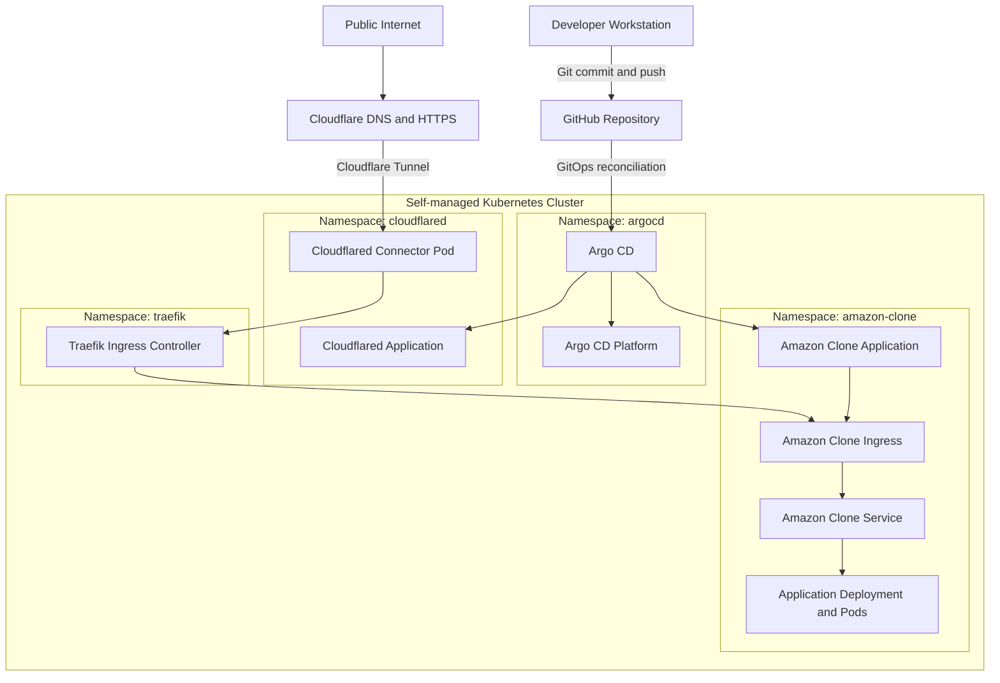
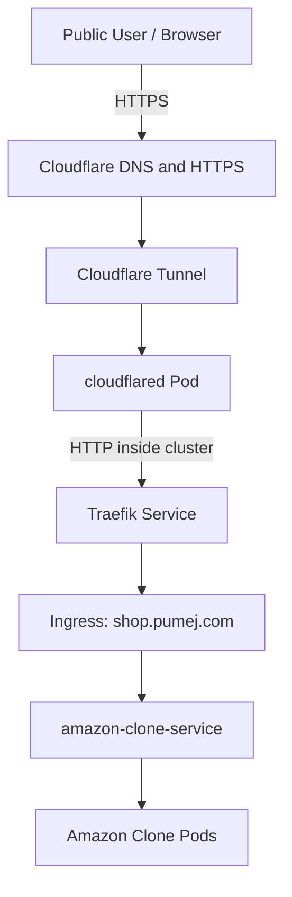

# Amazon Clone — Kubernetes GitOps Deployment with Argo CD, Traefik & Cloudflare Tunnel

[](https://kubernetes.io/)
[](https://argo-cd.readthedocs.io/)
[](https://traefik.io/)
[](https://www.cloudflare.com/)

A hands-on DevOps project deploying an Amazon Clone application to a self-managed Kubernetes locally built cluster, using **Argo CD for GitOps**, **Traefik for ingress routing**, **MetalLB for local load balancing**, and **Cloudflare Tunnel for secure public access**.


The application is publicly accessible over HTTPS, while the Argo CD management dashboard remains private.

**Live application:** <https://shop.pumej.com>  
**GitHub repository1:** <https://github.com/Mexxy-lab/Pumej_amazon-clone-app.git>
**GitHub repository2:** <https://github.com/Mexxy-lab/amazon-clone-app_argocd-manifest>

---

## Table of contents

1. [Project overview](#project-overview)
2. [Architecture](#architecture)
3. [Technology stack](#technology-stack)
4. [Application access](#application-access)
5. [Kubernetes and GitOps design](#kubernetes-and-gitops-design)
6. [Repository structure](#repository-structure)
7. [Cloudflare Tunnel configuration](#cloudflare-tunnel-configuration)
8. [TLS and DNS](#tls-and-dns)
9. [GitOps deployment workflow](#gitops-deployment-workflow)
10. [Useful commands](#useful-commands)
11. [Security considerations](#security-considerations)
12. [Project outcomes](#project-outcomes)

---

## Project overview

The goal of this project was to build and operate a Kubernetes-based application platform using DevOps and GitOps practices.

The application runs on a self-managed Kubernetes cluster. Its Kubernetes manifests are stored in GitHub and continuously reconciled by Argo CD.

The project evolved from a locally accessible Kubernetes application into a publicly accessible HTTPS application without exposing Kubernetes nodes directly to the internet or configuring router port forwarding.

The implementation also demonstrates an important infrastructure design principle: **the public application and the platform management interface should have separate access boundaries.**

- Amazon Clone is publicly accessible at `https://shop.pumej.com`.
- The local application endpoint is `https://amazon.test`.
- The Argo CD dashboard remains accessible through the local hostname `https://argocd.test`.
- Only the application hostname is published through Cloudflare Tunnel.

## Architecture

### High-level architecture



### Public application traffic flow



Cloudflare terminates public HTTPS and forwards traffic through the tunnel to the cloudflared connector running inside Kubernetes. The connector reaches Traefik through its internal Kubernetes Service DNS name.

Traefik uses the incoming hostname to route the request to the Amazon Clone Service.

### Local management traffic

The local access path is separate from the public tunnel:

- `amazon.test` routes to the Amazon Clone application.
- `argocd.test` routes to the Argo CD dashboard.
- Both use the local Traefik ingress and locally trusted TLS certificates.

Argo CD is not published as a Cloudflare public hostname.

---

## Technology stack

| Technology | Purpose |
| --- | --- |
| Kubernetes | Container orchestration |
| Argo CD | GitOps continuous delivery |
| Helm | Kubernetes package management |
| Traefik | Ingress controller and traffic routing |
| MetalLB | LoadBalancer implementation for the local cluster |
| Cloudflare Tunnel | Secure public connectivity without inbound port forwarding |
| Cloudflare DNS | Public DNS management |
| cert-manager | Certificate lifecycle management |
| Local Certificate Authority | Trusted TLS for local application endpoints |
| GitHub | Source control and GitOps repository |
| Jenkins | CI/CD pipeline integration |
| Docker | Containerization |

### Lab environment

The Kubernetes cluster consists of a control-plane node and a worker node.

| Component | Configuration |
| --- | --- |
| Kubernetes nodes | `master-node`, `worker-node1` |
| Kubernetes server | `v1.28.15` |
| Helm | `v3.19.4` |
| Argo CD Helm chart | `7.8.28` |
| Traefik | Helm-managed |
| MetalLB | Local LoadBalancer |
| Traefik LoadBalancer IP | `10.3.0.100` |
| Domain | `pumej.com` |
| Cloudflare plan | Free |

Versions represent the lab environment during implementation and may need adjustment when reproducing the project.

---

## Application access

| Application | URL | Access |
| --- | --- | --- |
| Amazon Clone | <https://shop.pumej.com> | Public HTTPS |
| Amazon Clone | <https://amazon.test> | Local HTTPS |
| Argo CD | <https://argocd.test> | Local/private HTTPS |

The public application is accessible from different computers and mobile devices without requiring access to the local network.

The Argo CD dashboard is intentionally excluded from the public tunnel configuration.

---

## Kubernetes and GitOps design

The cluster uses three standalone Argo CD Applications.

All three Application resources are stored in the `argocd` namespace.

| Argo CD Application | Responsibility | Workload namespace |
| --- | --- | --- |
| `amazon-clone` | Manages the application Kubernetes resources | `amazon-clone` |
| `argocd-platform` | Manages the Argo CD installation using Helm | `argocd` |
| `cloudflared` | Manages the Cloudflare Tunnel connector deployment | `cloudflared` |

### 1. Amazon Clone

The `amazon-clone` Application monitors the GitHub repository and deploys the Kubernetes manifests under:

```text
kubernetes/amazon-clone/
```

It manages the application's Deployment, Service, Ingress, namespace-related resources and certificate resources.

Automated synchronization, pruning and self-healing are enabled.

### 2. Argo CD platform

The `argocd-platform` Application manages the Argo CD installation using the official Argo Helm chart and values stored in Git.

This makes the Argo CD platform itself a GitOps-managed application.

The Helm chart and its values are maintained through a multi-source Argo CD Application configuration.

### 3. Cloudflared

The `cloudflared` Application deploys the Cloudflare Tunnel connector into the `cloudflared` namespace.

The tunnel token is stored in a Kubernetes Secret named:

```text
cloudflared-token
```

The Secret is provisioned separately and is deliberately excluded from Git.

The Cloudflare Tunnel is remotely managed through the Cloudflare dashboard.

---

## Repository structure

The repository contains the Kubernetes manifests, Argo CD Application definitions, Helm configuration and supporting deployment files.

```text
amazon-clone-app_argocd-manifest/
│
├── argocd-applications/
│   ├── amazon-clone-application.yaml
│   ├── argocd-platform-application.yaml
│   └── cloudflared-application.yaml
│
├── helm/
│   └── traefik/
│       └── values.yaml
│
├── kubernetes/
│   ├── amazon-clone/
│   │   ├── certificate.yml
│   │   ├── deployment.yaml
│   │   ├── ingress.yaml
│   │   ├── issuer.yml
│   │   ├── namespace.yaml
│   │   └── service.yaml
│   │
│   ├── argocd-platform/
│   │   ├── argocd-certificate.yaml
│   │   └── values.yaml
│   │
│   └── cloudflared/
│       ├── namespace.yaml
│       └── deployment.yaml
│
├── deployment.yml
├── issuer.yml
├── jenkinsfile
├── Training.md
└── README.md
```

---

## Cloudflare Tunnel configuration

Cloudflare Tunnel provides public access to the application without exposing the Kubernetes nodes through public inbound ports.

The tunnel connector runs as a Kubernetes Deployment in the `cloudflared` namespace.

### Published hostname

```text
shop.pumej.com
```

### Cloudflare origin service

```text
http://traefik.traefik.svc.cluster.local:80
```

The tunnel forwards traffic to Traefik over HTTP inside the Kubernetes cluster.

Cloudflare provides the public HTTPS endpoint.

### DNS configuration

Cloudflare manages authoritative DNS for `pumej.com`.

The public hostname is configured as a CNAME pointing to the Cloudflare Tunnel:

```text
shop.pumej.com
    CNAME
ad674afd-0d75-4ce1-8d50-802c8cd5b057.cfargotunnel.com
```

The tunnel identifier is shown here as the public DNS target, not as a credential.

The domain's existing IONOS email DNS records were preserved during the DNS migration.

### Tunnel security

- No router port forwarding is required.
- No public Kubernetes node IP is required.
- The tunnel connector establishes outbound connectivity to Cloudflare.
- Only `shop.pumej.com` is published.
- Argo CD remains private.

---

## TLS and DNS

Two different TLS arrangements are used.

### Local TLS

cert-manager and a local Certificate Authority issue certificates for:

- `amazon.test`
- `argocd.test`

The local CA certificate is trusted on the Windows workstation so that browsers can access these local HTTPS endpoints without certificate warnings.

### Public TLS

For `shop.pumej.com`, Cloudflare provides public HTTPS.

The public browser connection uses HTTPS, while Cloudflare Tunnel forwards traffic to the internal Traefik HTTP service on port 80.

This keeps the public TLS configuration separate from the local certificate authority.

---

## GitOps deployment workflow

The project follows a Git-based deployment workflow.

1. Make a change to the Kubernetes manifests.
2. Validate the YAML and Kubernetes configuration.
3. Commit and push the changes to the GitHub `main` branch.
4. Argo CD detects the repository changes.
5. The corresponding Application synchronizes the desired state.
6. Kubernetes applies the changes and reconciles the workloads.
7. Argo CD reports synchronization and health status.

Example:

```bash
git add kubernetes/amazon-clone/

git commit -m "Update Amazon Clone deployment"

git push origin main
```

Check Argo CD Applications:

```bash
kubectl get applications -n argocd
```

Check the application resources:

```bash
kubectl get deployments,pods,services,ingress -n amazon-clone
```

Check the Cloudflare connector:

```bash
kubectl get pods -n cloudflared
```

---

## Useful commands

### Check Argo CD Applications

```bash
kubectl get applications -n argocd
```

### Check application resources

```bash
kubectl get all -n amazon-clone
```

### Check Ingress rules

```bash
kubectl get ingress -n amazon-clone
```

### Check Traefik

```bash
kubectl get pods,svc -n traefik
```

### Check Cloudflared

```bash
kubectl get deployments,pods -n cloudflared
```

### Review Cloudflared logs

```bash
kubectl logs deployment/cloudflared -n cloudflared
```

### Check the public application

```bash
curl -I https://shop.pumej.com
```

Expected response:

```text
HTTP/2 200
```

### Check local application routing

```bash
curl -I https://amazon.test
```

### Check certificate resources

```bash
kubectl get certificates -A
```

---

## Security considerations

Security was considered throughout the implementation.

- The Cloudflare Tunnel token is stored in a Kubernetes Secret and is not committed to Git.
- Argo CD is not exposed through the public Cloudflare Tunnel.
- The public application is accessed through Cloudflare HTTPS.
- Local TLS certificates are managed separately from public TLS.
- No inbound router port forwarding is needed.

For production use, additional controls such as Kubernetes NetworkPolicies, stronger secret management, image vulnerability scanning, access controls and regular patching should be considered.

---

## Project outcomes

This project demonstrates the implementation of a self-managed Kubernetes environment with GitOps-based application delivery and secure public connectivity.

Key outcomes:

- Deployed an application on a multi-node Kubernetes cluster.
- Implemented GitOps using Argo CD.
- Managed the Argo CD platform itself through an Argo CD Application and Helm.
- Configured Traefik for Kubernetes ingress routing.
- Implemented MetalLB for local LoadBalancer functionality.
- Configured local TLS using cert-manager and a trusted local CA.
- Deployed Cloudflare Tunnel as a Kubernetes workload.
- Published the application using a custom domain and Cloudflare HTTPS.
- Kept the Argo CD management interface private.
- Verified public access from multiple computers and mobile devices.

**Live application:** <https://shop.pumej.com>

**Source code:** <https://github.com/Mexxy-lab/amazon-clone-app_argocd-manifest>

---

## Final note

This is a hands-on learning project demonstrating Kubernetes administration, GitOps, ingress management, TLS, DNS and secure application exposure.

The infrastructure is designed to be reproducible and continuously managed through version-controlled configuration.
