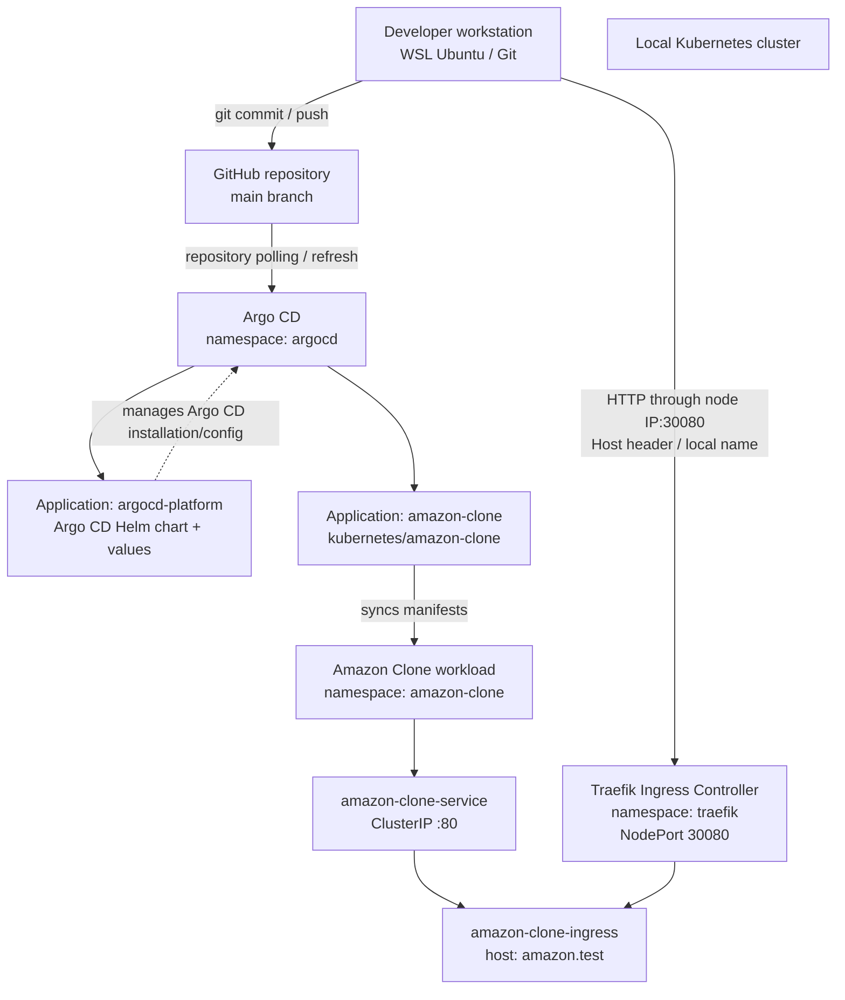
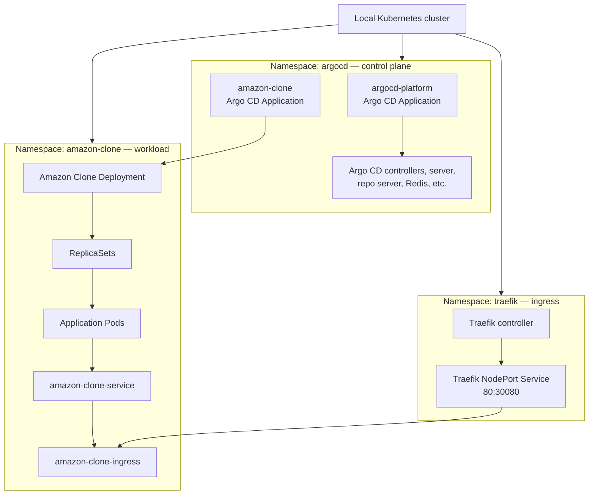

# Amazon Clone GitOps Deployment with Argo CD

> **Project status:** Local Kubernetes GitOps implementation is working. Both Argo CD Applications are currently reported as `Synced` and `Healthy`. This README documents the implementation **before HTTPS is introduced for either application**.
>
> **Next milestone:** Implement HTTPS for the `amazon-clone` application. HTTPS for the Argo CD platform is outside the current completed scope and should be handled separately.

---

## Table of contents

1. [Project overview](#project-overview)
2. [Goals](#goals)
3. [Architecture](#architecture)
4. [Repository layout](#repository-layout)
5. [Environment and versions](#environment-and-versions)
6. [Namespaces and application ownership](#namespaces-and-application-ownership)
7. [Argo CD Applications](#argo-cd-applications)
8. [Traefik ingress and current HTTP access](#traefik-ingress-and-current-http-access)
9. [GitOps workflow](#gitops-workflow)
10. [Health checks](#health-checks)
11. [Deployment and validation commands](#deployment-and-validation-commands)
12. [Troubleshooting notes](#troubleshooting-notes)
13. [Current state and known considerations](#current-state-and-known-considerations)
14. [Next milestone: HTTPS for Amazon Clone](#next-milestone-https-for-amazon-clone)

---

## Project overview

This project deploys an Amazon Clone application to a local Kubernetes cluster and uses Argo CD to manage the application through GitOps.

The Git repository is:

```text
https://github.com/Mexxy-lab/amazon-clone-app_argocd-manifest.git
```

The main branch is:

```text
main
```

The implementation intentionally uses **two standalone Argo CD Applications**. It does not use an App-of-Apps pattern:

- `argocd-platform` manages the Argo CD platform through the official Argo Helm chart and Git-managed Helm values.
- `amazon-clone` manages the Amazon Clone Kubernetes manifests stored in this repository.

The actual Amazon Clone workload runs in the `amazon-clone` namespace. Both Argo CD Application custom resources are kept in the `argocd` namespace.

## Goals

- Deploy and manage the Amazon Clone workload declaratively through Git.
- Use Argo CD to compare Git desired state with live Kubernetes state.
- Separate platform management from application workload management.
- Use Traefik as the local Ingress controller.
- Make both Applications visible in the Argo CD dashboard.
- Report meaningful application and Ingress health.
- Keep the local implementation usable without a cloud load balancer.
- Establish a clean baseline before adding HTTPS.

## Architecture

### High-level component diagram



### Namespace view



**Namespace distinction:** `metadata.namespace` on an Argo CD `Application` is where the Application custom resource is stored. `spec.destination.namespace` is where the managed workload resources are deployed. The Amazon Clone Application belongs in `argocd`, with its destination set to `amazon-clone`.

## Repository layout

The implementation uses the following key paths. The repository may contain additional application source files and supporting manifests.

```text
amazon-clone-app_argocd-manifest/
├── argocd-applications/
│   ├── argocd-platform-application.yaml
│   └── amazon-clone-application.yaml
│
├── kubernetes/
│   ├── argocd-platform/
│   │   └── values.yaml
│   │
│   └── amazon-clone/
│       ├── deployment.yaml
│       ├── service.yaml
│       ├── ingress.yaml
│       └── certificate.yml             # Present in repo; HTTPS is not yet implemented
│
└── README.md
```

The exact names of workload files should be checked against the current repository tree. The main paths used by Argo CD are:

- `argocd-applications/argocd-platform-application.yaml`
- `argocd-applications/amazon-clone-application.yaml`
- `kubernetes/argocd-platform/values.yaml`
- `kubernetes/amazon-clone/`

### What each directory does

| Path | Responsibility |
| --- | --- |
| `argocd-applications/` | Contains standalone Argo CD Application definitions. |
| `kubernetes/argocd-platform/` | Contains Helm values for the Argo CD platform. |
| `kubernetes/amazon-clone/` | Contains the Kubernetes resources for the Amazon Clone workload. |

The Application definitions are not themselves managed by an App-of-Apps Application. If one of these Application definition files changes, apply that definition with `kubectl apply` (or another explicitly configured mechanism). Changes under the managed workload path are detected by the corresponding Application.

## Environment and versions

The local lab context recorded during implementation:

| Component | Version / configuration |
| --- | --- |
| Kubernetes server | `v1.28.15` |
| kubectl client | `v1.35.0` |
| Helm | `v3.19.4` |
| Argo CD Helm chart | `argo-cd` chart `7.8.28` |
| Argo CD application version | `v2.14.11` |
| Ingress controller | Traefik |
| Traefik Service | `NodePort`, port mapping `80:30080/TCP` |
| Kubernetes cluster/master node IP | `192.168.1.120` |
| Argo CD namespace | `argocd` |
| Amazon Clone namespace | `amazon-clone` |
| Traefik namespace | `traefik` |

> Kubernetes client/server version skew is larger than the recommended range in this lab. It has not been established as the cause of the issues documented below, but it is a future maintenance consideration.

## Namespaces and application ownership

The intended resource ownership is:

| Resource | Namespace | Managed by |
| --- | --- | --- |
| `argocd-platform` Application CR | `argocd` | Applied as an Application definition |
| `amazon-clone` Application CR | `argocd` | Applied as an Application definition |
| Argo CD Helm resources | `argocd` | `argocd-platform` |
| Amazon Clone Deployment / Pods | `amazon-clone` | `amazon-clone` |
| Amazon Clone Service | `amazon-clone` | `amazon-clone` |
| Amazon Clone Ingress | `amazon-clone` | `amazon-clone` |
| Traefik controller and Service | `traefik` | Traefik Helm installation |

A duplicate `amazon-clone` Application CR was accidentally created in the `amazon-clone` namespace while changing the manifest. That duplicate had no finalizer and was removed. The correct Application is in `argocd`; its destination remains `amazon-clone`.

## Argo CD Applications

### 1. `argocd-platform`

The platform Application uses a multi-source configuration:

1. The official Argo Helm chart repository.
2. The Git repository that stores the chart values.

The Helm chart source is intentionally first; the Git source is referenced using `ref: values`.

Representative configuration:

```yaml
apiVersion: argoproj.io/v1alpha1
kind: Application
metadata:
  name: argocd-platform
  namespace: argocd

spec:
  project: default

  sources:
    - repoURL: https://argoproj.github.io/argo-helm
      chart: argo-cd
      targetRevision: 7.8.28
      helm:
        releaseName: argocd-platform
        valueFiles:
          - $values/kubernetes/argocd-platform/values.yaml

    - repoURL: https://github.com/Mexxy-lab/amazon-clone-app_argocd-manifest.git
      targetRevision: main
      ref: values

  destination:
    server: https://kubernetes.default.svc
    namespace: argocd

  # Automated sync may be enabled in the current manifest.
  # Check the file in Git for the authoritative policy.
```

The platform Application is designed to manage Argo CD itself, including its chart-managed controllers, Deployments, StatefulSet, Services, ConfigMaps, RBAC resources, and its Traefik IngressRoute.

**Multi-source revision display note:** Because this Application combines a Helm chart source and a Git values source, its revision and commit metadata presentation in the Argo CD dashboard can differ from a single-source Git Application. Reordering the Git source before the Helm source caused a repository error (`git fetch` attempted against the Helm repository URL); keep the Helm chart source first.

### 2. `amazon-clone`

The Amazon Clone Application uses a single Git source:

```yaml
apiVersion: argoproj.io/v1alpha1
kind: Application
metadata:
  name: amazon-clone
  namespace: argocd

spec:
  project: default

  source:
    repoURL: https://github.com/Mexxy-lab/amazon-clone-app_argocd-manifest.git
    targetRevision: main
    path: kubernetes/amazon-clone

  destination:
    server: https://kubernetes.default.svc
    namespace: amazon-clone

  syncPolicy:
    automated:
      prune: true
      selfHeal: true
    syncOptions:
      - CreateNamespace=true
```

This Application:

- Monitors `main` at `kubernetes/amazon-clone`.
- Automatically synchronizes detected changes.
- Enables self-healing if live resources are manually changed.
- Enables pruning: resources removed from the Git path may be deleted from the cluster.
- Creates the target namespace if it does not exist.

### Manual versus automated synchronization

| Application | Intended sync behavior |
| --- | --- |
| `amazon-clone` | Automated sync; prune and self-heal enabled |
| `argocd-platform` | Automated sync is configurable; historically manual during adoption and troubleshooting. Check the current Git manifest. |

A `git push` to the Amazon Clone manifests does not require `kubectl apply` of the Application definition on every update. `kubectl apply` is needed when registering or changing the Application CR itself, unless a separate mechanism manages that definition.

## Traefik Ingress and current HTTP access

Traefik is installed in namespace `traefik` as a NodePort Service:

```text
Service:     traefik
Type:        NodePort
Cluster IP:  10.110.4.217
Port:        80:30080/TCP
External IP: none
```

The local cluster/node IP recorded for access is:

```text
192.168.1.120
```

### Amazon Clone Ingress

The current Amazon Clone Ingress is HTTP-only:

```yaml
apiVersion: networking.k8s.io/v1
kind: Ingress
metadata:
  name: amazon-clone-ingress
  namespace: amazon-clone
spec:
  ingressClassName: traefik
  rules:
    - host: amazon.test
      http:
        paths:
          - path: /
            pathType: Prefix
            backend:
              service:
                name: amazon-clone-service
                port:
                  number: 80
```

### Argo CD platform Ingress

The Argo CD dashboard is routed using a Traefik `IngressRoute` named `argocd-ingress` in namespace `argocd`, with the host `argocd.test` and backend `argocd-platform-server` on port 80 using HTTP.

The Argo CD chart values include:

```yaml
configs:
  params:
    server.insecure: true
```

This config allows Argo CD server HTTP behind the local Traefik ingress. HTTPS for the Argo CD platform has not been implemented as part of this milestone.

### Local hostname resolution and access

The local hostnames used are:

- `argocd.test`
- `amazon.test`

They must resolve to the local Kubernetes node IP (`192.168.1.120`) on the client machine that opens the browser. Use the local DNS/hosts setup appropriate to the workstation.

Traefik receives HTTP on NodePort `30080`. A basic route test can be performed from a machine with network access to the node:

```bash
curl -I -H "Host: amazon.test" http://192.168.1.120:30080
```

For the Argo CD dashboard:

```bash
curl -I -H "Host: argocd.test" http://192.168.1.120:30080
```

These commands test HTTP routing only; they do not test TLS.

## GitOps workflow

### Typical Amazon Clone change

1. Edit the Kubernetes manifests in `kubernetes/amazon-clone/`.
2. Validate the change.
3. Commit and push to `main`.
4. Argo CD detects the new revision through repository polling (or a configured webhook).
5. The `amazon-clone` Application automatically syncs.
6. Kubernetes rolls out the updated workload.
7. Argo CD reports sync and health status.

Example:

```bash
git add kubernetes/amazon-clone/
git commit -m "Update Amazon Clone deployment"
git push origin main
```

Check the Application:

```bash
kubectl get application amazon-clone -n argocd
```

Check Deployment rollout:

```bash
kubectl rollout status deployment/amazon-deployment -n amazon-clone
```

Check Pods:

```bash
kubectl get pods -n amazon-clone
```

### Polling versus browser refresh

Argo CD repository polling and the dashboard's browser refresh are different:

- Repository polling discovers Git changes.
- Automated sync applies detected changes.
- Browser refresh updates the displayed state.

A browser refresh does not itself deploy a commit. When debugging a delayed update, verify the Application's observed revision, sync status, desired replica count, and live Deployment replica count.

Hard refresh can be requested with:

```bash
kubectl annotate application amazon-clone -n argocd \
  argocd.argoproj.io/refresh=hard --overwrite
```

A GitHub webhook can be added later to reduce the delay caused by periodic polling. Webhook configuration should be planned for the local environment and its network reachability.

## Health checks

### Ingress health behavior

The local Traefik Service is NodePort and has no external IP. Consequently, the Ingress object's status can have no `status.loadBalancer.ingress` address:

```bash
kubectl get ingress amazon-clone-ingress -n amazon-clone \
  -o jsonpath='{.status.loadBalancer.ingress}{"\n"}'
```

Argo CD's default Ingress health assessment may continue to report `Progressing` when no load-balancer status address is populated, even though Traefik is routing traffic.

A custom health check was added to the Argo CD ConfigMap through the platform Helm values. It treats an Ingress with routing rules as healthy without requiring a load-balancer address. This is suitable for this local NodePort arrangement, but it does **not** prove that the backend is reachable; test the HTTP route separately.

The health customization is stored under `configs.cm` in:

```text
kubernetes/argocd-platform/values.yaml
```

The live customization can be inspected with:

```bash
kubectl get configmap argocd-cm -n argocd \
  -o jsonpath='{.data.resource\.customizations\.health\.networking\.k8s\.io_Ingress}{"\n"}'
```

### Current expected health

At the point this README was prepared, the user reported both Applications healthy:

```text
argocd         amazon-clone      Synced   Healthy
argocd         argocd-platform   Synced   Healthy
```

## Deployment and validation commands

### List Applications

```bash
kubectl get applications -A
```

### Inspect Amazon Clone Application source and destination

```bash
kubectl get application amazon-clone -n argocd \
  -o jsonpath='{.spec.source.repoURL}{"\n"}{.spec.source.targetRevision}{"\n"}{.spec.source.path}{"\n"}{.spec.destination.namespace}{"\n"}'
```

Expected key values:

```text
https://github.com/Mexxy-lab/amazon-clone-app_argocd-manifest.git
main
kubernetes/amazon-clone
amazon-clone
```

### Inspect workload resources

```bash
kubectl get deploy,rs,pods,svc,ingress -n amazon-clone
```

### Check desired and ready replicas

```bash
kubectl get deployment amazon-deployment -n amazon-clone \
  -o jsonpath='Desired: {.spec.replicas}{"\n"}Ready: {.status.readyReplicas}{"\n"}'
```

### Inspect Argo CD platform health

```bash
kubectl get application argocd-platform -n argocd
```

### Inspect Traefik

```bash
kubectl get pods,svc -n traefik
```

## Troubleshooting notes

### Application shows `OutOfSync`

Inspect the resource diff in the Argo CD dashboard before syncing. A platform Application that manages Argo CD itself should be handled carefully. During the initial Helm-to-Argo adoption, the live resources were Helm-installed and lacked Argo CD tracking annotations. After verifying that the differences were tracking metadata, a controlled sync was performed.

The platform Application then became `Synced` and `Healthy`; the live ConfigMap received a tracking annotation such as:

```text
argocd-platform:/ConfigMap:argocd/argocd-cm
```

### Application status is blank or `Unknown`

Check that the Application CR is in the `argocd` namespace:

```bash
kubectl get applications -A
```

A duplicate `amazon-clone` Application was previously created in namespace `amazon-clone`. It had no finalizer and was removed. Do not recreate the Application CR in the workload namespace.

### Amazon Clone is still running the old replica count

Check these separately:

1. Is Argo CD observing the latest Git revision?
2. Is the Application `OutOfSync` or `Synced`?
3. Is automated sync enabled on the Application?
4. What is the Deployment's `.spec.replicas`?
5. How many Pods are ready?

Commands:

```bash
kubectl get application amazon-clone -n argocd
kubectl get application amazon-clone -n argocd \
  -o jsonpath='{.status.sync.revision}{"\n"}{.spec.syncPolicy.automated}{"\n"}'
kubectl get deployment amazon-deployment -n amazon-clone \
  -o jsonpath='{.spec.replicas}{" / "}{.status.readyReplicas}{"\n"}'
```

### Traefik Ingress remains `Progressing`

For this local setup, an empty Ingress load-balancer status is expected because Traefik is exposed by NodePort. Verify the custom health check is present and test the actual route with the host header. Do not add a fake external IP merely to satisfy the health display.

### Argo CD dashboard repository error

The platform Application is multi-source. The Helm chart source must remain first, followed by the Git values source. Moving the Git source ahead of the Helm chart previously led to an attempt to `git fetch` the Helm repository URL and a repository-not-found error. Restore the Helm-first ordering.

## Current state and known considerations

- Both standalone Argo CD Applications are in namespace `argocd`.
- The `amazon-clone` Application destination is namespace `amazon-clone`.
- Amazon Clone Deployment, Service and Ingress are in namespace `amazon-clone`.
- Traefik is installed in namespace `traefik` and exposed through NodePort `30080`.
- The local routes are HTTP-only at this stage.
- Argo CD platform custom Ingress health behavior is configured to accommodate NodePort/no-load-balancer status.
- `amazon-clone` is configured for automated sync with prune and self-heal.
- The current polling behavior should be verified when troubleshooting delayed updates; browser refresh is not equivalent to repository refresh or sync.
- No App-of-Apps pattern is used.
- HTTPS has **not yet been implemented for either `amazon.test` or `argocd.test`**.

## Next milestone: HTTPS for Amazon Clone

The next implementation step is to enable HTTPS for the Amazon Clone application while preserving the current HTTP baseline and keeping the Argo CD platform changes separate.

Before changing manifests, establish the intended TLS approach for the local lab. Typical choices include:

- A locally trusted certificate authority and a certificate for `amazon.test`.
- A development/self-signed certificate (browser warnings unless trusted).
- `cert-manager` with a local CA issuer, if certificate lifecycle automation is desired.

The HTTPS work should address, in sequence:

1. Certificate strategy and trust on the client workstation.
2. TLS secret/certificate resources in namespace `amazon-clone`.
3. Traefik Ingress TLS configuration for host `amazon.test`.
4. HTTPS routing validation.
5. Optional HTTP-to-HTTPS redirect.
6. Argo CD sync and health validation.
7. Documentation update after HTTPS is verified.

The existing Amazon Clone Ingress and any certificate manifest should be reviewed before edits. Do not assume an existing `certificate.yml` is active or complete without checking its current contents.

**Baseline to preserve:** The application should continue to be managed by the `amazon-clone` Application in `argocd`, with workload resources deployed into namespace `amazon-clone`. HTTPS should be introduced as a change to that workload's Git manifests, not by moving the Application custom resource.

## Deployment of amazon clone app

```bash
# Register the Amazon Clone application with Argo CD.
kubectl apply -f application.yaml

# Check the application status.
kubectl get applications -n argocd

# Inspect synchronization and health status.
kubectl describe application amazon-clone -n argocd
# Check the application namespace.
kubectl get namespaces

# Check the Amazon Clone deployment.
kubectl get deployments -n amazon-clone

# Check the pods.
kubectl get pods -n amazon-clone -o wide

# Check the Service.
kubectl get services -n amazon-clone

# Check the Argo CD application.
kubectl get application amazon-clone -n argocd


# Forward local port 8083 to the application's Service port 80.
kubectl port-forward -n amazon-clone \
  service/amazon-clone-service 8083:80

Then access:

http://localhost:8083

Keep that terminal open while testing.
```
